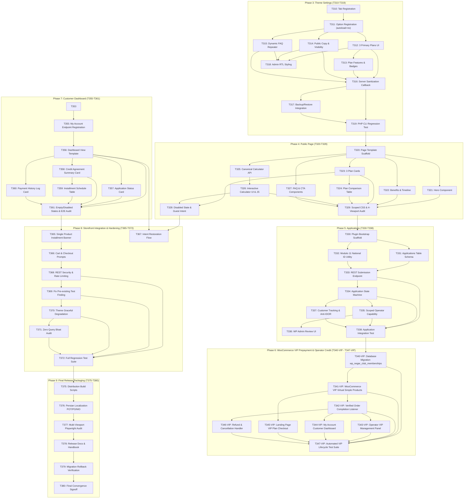

# Tasks: NegarThem Advanced Customer Club & Installment System (013-customer-club)

**Branch**: `main` (integrated from `feat/013-customer-club`) | **Date**: 2026-11-19
**Spec**: [specs/013-customer-club/spec.md](file:///x:/apps/wamp/www\wp4\wp-content\themes\negarThem\specs\013-customer-club\spec.md)
**Plan**: [specs/013-customer-club/plan.md](file:///x:/apps/wamp\www\wp4\wp-content\themes\negarThem\specs\013-customer-club\plan.md)
**Approved Baseline**: `40d48aef54180681ee2add2fb12fb33a13fe6fd9`
**Review Gate Status**: `Review-plan approved by external reviewer for implementation task generation; financial activation remains separately gated.`

---

## Overview & Execution Rules

1. **One Task at a Time**: In accordance with the Negar Shop Constitution and Spec Kit discipline, execute only **one task at a time**.
2. **Commit Discipline**: Each task must be delivered with a dedicated Conventional Commit (`feat(customer-club): description (T###)` or `test(customer-club): description (T###)`).
3. **Traceability**: All 64 tasks map 1:1 to the 64 Acceptance Criteria (`CLUB-AC-001`–`CLUB-AC-064`) and 14 User Stories (`CLUB-US-01`–`CLUB-US-14`).
4. **Financial Activation Guard**: Phase 6 tasks are strictly **BLOCKED** until all commercial decisions (`CLUB-BD-001` through `CLUB-BD-022`) and architectural decisions (`CLUB-AD-001`, `CLUB-AD-002`) receive explicit employer approval.
5. **No Database Writes in Documentation Phases**: Zero application code or database mutations occur during planning. Implementation begins with Phase 3 upon subsequent authorization.

---

## Format: `[ID] [P?] [Phase/Story] Description`
- **[P]**: Can run in parallel (different files, independent interfaces).
- **[Story]**: Mapped User Story from `spec.md` (e.g. `US-09`, `US-01`, `US-14`).
- **[AC]**: Mapped Acceptance Criteria from `acceptance-matrix.md`.

---

## Phase 3: Theme Settings (Highest Priority — Ready for Implementation)

**Goal**: Enable store administrators to configure general customer club settings, page content, FAQs, visibility toggles, and three primary plans (`negar_aghaz`, `negar_plus`, `negar_vizhe`) from the existing NegarThem settings interface (`inc/theme-settings.php`) with robust sanitization and backup support.

**Independent Test**: Configure all fields in the WordPress admin «باشگاه مشتریان» tab, save changes, verify database storage in `negar_theme_club_options` with `autoload = 'no'`, test invalid inputs (e.g. initial payment > ceiling) to verify error notices, export theme backup JSON, and verify data roundtrip.

### Tasks for Phase 3:

- [x] **T310** [Phase 3] [US-09] [AC: CLUB-AC-004] Register «باشگاه مشتریان» settings tab in `inc/theme-settings.php`
  - **Objective**: Add `customer_club` tab to `negar_theme_settings_tabs()` with icon, title «باشگاه مشتریان», and registration in tab renderer.
  - **Files**: `inc/theme-settings.php`
  - **Acceptance Criteria**: Admin settings page displays the new tab; active tab highlights properly in RTL layout; clicking tab loads club settings pane without PHP notices.
  - **Required Tests**: PHP syntax check (`npm run test:lint`); admin page HTTP 200 verification.
  - **Dependencies**: None (Can start immediately upon Phase 3 authorization).

- [x] **T311** [Phase 3] [US-09, US-11] [AC: CLUB-AC-004, CLUB-AC-011] Register `negar_theme_club_options` setting in WordPress Settings API with non-autoload storage
  - **Objective**: Call `register_setting()` for `negar_theme_club_options` group with default options structure (`is_enabled`, `allow_applications`, `plans`, `sections_visibility`, `copy`) and explicitly set `autoload = 'no'`.
  - **Files**: `inc/theme-settings.php`
  - **Acceptance Criteria**: Option is stored in `wp_options` with `autoload = 'no'`; default values populate automatically when option does not exist.
  - **Required Tests**: CLI check verifying `autoload` flag in `wp_options`.
  - **Dependencies**: T310.

- [x] **T312** [Phase 3] [US-10] [AC: CLUB-AC-007, CLUB-AC-008] Implement plan configuration UI for the 3 primary fixed plans
  - **Objective**: Render settings fields for 3 plans (`negar_aghaz`, `negar_plus`, `negar_vizhe`): editable title, subtitle/tagline, initial payment (`IRT`), purchase ceiling (`IRT`), term duration (months), and featured plan flag.
  - **Files**: `inc/theme-settings.php`
  - **Acceptance Criteria**: All 3 plans render distinct input cards; inputs display formatted Persian labels; monetary fields indicate `تومان`; fixed plan identifiers cannot be altered by admin.
  - **Required Tests**: Visual inspection of admin UI; form submission roundtrip test.
  - **Dependencies**: T311.

- [x] **T313** [P] [Phase 3] [US-10] [AC: CLUB-AC-009, CLUB-AC-010] Implement plan feature bullet lists, badges, and per-plan enabled toggles
  - **Objective**: Add repeater / textarea for plan feature bullet items, marketing badge text (e.g. «انتخاب محبوب»), and individual plan enable/disable toggles.
  - **Files**: `inc/theme-settings.php`
  - **Acceptance Criteria**: Feature list parses line breaks or arrays cleanly; badge text renders in admin preview; disabled plans persist their state.
  - **Required Tests**: Unit test parsing feature strings into sanitized array.
  - **Dependencies**: T312.

- [x] **T314** [P] [Phase 3] [US-09] [AC: CLUB-AC-005, CLUB-AC-006] Implement public page copy controls and section visibility toggles
  - **Objective**: Render settings fields for Hero heading/subheading, How-It-Works timeline steps, primary CTA copy, disabled notice copy, and independent section visibility switches (benefits, comparison, calculator, timeline, faq).
  - **Files**: `inc/theme-settings.php`
  - **Acceptance Criteria**: Each section toggle saves boolean state; text fields support Persian typography; disabled notice copy is editable.
  - **Required Tests**: Settings form save test with toggles on/off.
  - **Dependencies**: T311.

- [x] **T315** [P] [Phase 3] [US-09] [AC: CLUB-AC-006] Implement dynamic FAQ accordion management repeater in settings
  - **Objective**: Implement dynamic question/answer repeater field allowing store managers to add, edit, reorder, and delete FAQ items for the customer club landing page.
  - **Files**: `inc/theme-settings.php`, `assets/js/admin-settings.js` (or inline admin script)
  - **Acceptance Criteria**: Store manager can add multiple FAQ rows; empty rows are pruned on save; HTML in answers is sanitized with `wp_kses_post()`.
  - **Required Tests**: Form submission with 3 FAQ items; verify sanitized storage.
  - **Dependencies**: T311.

- [x] **T316** [Phase 3] [US-10, US-11] [AC: CLUB-AC-013, CLUB-AC-014] Implement server-side sanitization and validation callback `negar_theme_sanitize_club_settings`
  - **Objective**: Register validation callback enforcing: `is_enabled` and `allow_applications` as booleans; positive integer amounts; `initial_payment <= purchase_ceiling`; `terms > 0`; text escaping via `sanitize_text_field()` and `wp_kses_post()`; add administrative error notices via `add_settings_error()` on violation.
  - **Files**: `inc/theme-settings.php`
  - **Acceptance Criteria**: Submitting `initial_payment > purchase_ceiling` rejects invalid values, preserves previous valid state, and outputs accessible Persian error notice; zero XSS payloads survive sanitization.
  - **Required Tests**: PHPUnit / CLI test asserting sanitization boundaries and rejection logic.
  - **Dependencies**: T312, T313, T314, T315.

- [x] **T317** [Phase 3] [US-09] [AC: CLUB-AC-015] Register `negar_theme_club_options` in `inc/theme-backup.php` for backup and restore
  - **Objective**: Register `NEGAR_THEME_CLUB_OPTION` in `negar_theme_backup_supported_groups()` with sanitization callback, allowing JSON export, preview validation, and import.
  - **Files**: `inc/theme-backup.php`, `inc/theme-settings.php`
  - **Acceptance Criteria**: Export backup JSON includes `negar_theme_club_options`; import preview parses and validates data; applying backup restores all club settings without data loss.
  - **Required Tests**: PHP unit test verifying export payload and import restoration roundtrip.
  - **Dependencies**: T316.

- [x] **T318** [P] [Phase 3] [US-09, NFR-004] [AC: CLUB-AC-053] Apply Admin RTL styling consistency and accessible markup
  - **Objective**: Style the «باشگاه مشتریان» settings tab with standard WordPress admin classes, CSS grid/flexbox, RTL alignment, crimson accent colors, and clear field descriptions.
  - **Files**: `inc/theme-settings.php`, `assets/css/admin-settings.css` (if applicable)
  - **Acceptance Criteria**: Admin layout aligns strictly to the right in Persian locale; input fields have high contrast and clear focus states; responsive down to tablet viewports.
  - **Required Tests**: Visual verification in browser at 1024px and 1440px.
  - **Dependencies**: T312, T314, T315.

- [x] **T319** [Phase 3] [US-09, US-10] [AC: CLUB-AC-004..016] Implement focused PHP CLI regression test suite for theme settings
  - **Objective**: Create `tests/club-settings-regression.php` testing option registration, non-autoload verification, default values, sanitization constraints, error generation, and backup compatibility without mutating production data.
  - **Files**: `tests/club-settings-regression.php`
  - **Acceptance Criteria**: 100% assertions pass; clean exit code 0; verified by `npm run test:lint`.
  - **Required Tests**: `php tests/club-settings-regression.php` execution.
  - **Dependencies**: T316, T317.

**Checkpoint**: Phase 3 complete. Store managers can fully configure the Customer Club in WordPress admin.

---

## Phase 4: Public Customer Club Page

**Goal**: Deliver a responsive, high-fidelity Persian RTL Customer Club landing page (`/customer-club/`), showcasing plan cards, comparison matrix, interactive installment preview calculator, FAQ accordion, and transparent non-binding terms.

**Independent Test**: Load `/customer-club/` across 4 viewports (`375px`, `768px`, `1024px`, `1440px`), verify responsive RTL rendering without overflow, interact with calculator (Persian digits, slider/input sync, exact server parity), verify plan card links route to login modal for guests, and verify disabled state when turned off in settings.

### Tasks for Phase 4:

- [x] **T320** [Phase 4] [US-01] [AC: CLUB-AC-001] Create public page template `page-templates/page-customer-club.php`
  - **Objective**: Scaffold page template with WordPress header/footer hooks, container wrappers (`--container-width: 1320px`), breadcrumb integration, and modular template-part includes.
  - **Files**: `page-templates/page-customer-club.php`
  - **Acceptance Criteria**: Page loads cleanly; HTTP 200; proper HTML5 semantic tags; respects `is_enabled` toggle from settings.
  - **Required Tests**: Playwright HTTP status check; linting check.
  - **Dependencies**: Phase 3 complete.

- [x] **T321** [P] [Phase 4] [US-01] [AC: CLUB-AC-001] Implement Hero section component `template-parts/customer-club/hero.php`
  - **Objective**: Render hero banner with Persian headline, value proposition subtitle, trust badges, and anchor link CTA to plan cards.
  - **Files**: `template-parts/customer-club/hero.php`
  - **Acceptance Criteria**: Text loads dynamically from `negar_theme_club_options`; fallback copy displays if option empty; CTA smoothly scrolls to plans.
  - **Required Tests**: Visual verification on 375px mobile and 1440px desktop.
  - **Dependencies**: T320.

- [x] **T322** [P] [Phase 4] [US-01] [AC: CLUB-AC-001] Implement Benefits and How-It-Works timeline components
  - **Objective**: Create `template-parts/customer-club/benefits.php` (4 trust cards with accessible SVG icons) and `template-parts/customer-club/steps.php` (step-by-step application and purchase timeline).
  - **Files**: `template-parts/customer-club/benefits.php`, `template-parts/customer-club/steps.php`
  - **Acceptance Criteria**: Clean RTL layout; SVG icons without raw emojis; steps clearly explain application → review → purchase → installment payoff.
  - **Required Tests**: Visual inspection; accessibility contrast check.
  - **Dependencies**: T320.

- [x] **T323** [Phase 4] [US-02] [AC: CLUB-AC-002] Implement three-tier plan cards component `template-parts/customer-club/plans.php`
  - **Objective**: Render 3 responsive cards for `negar_aghaz`, `negar_plus`, `negar_vizhe` showing formatted Toman amounts, installment term, bullet features, featured badge («انتخاب محبوب»), and CTA button («درخواست طرح»).
  - **Files**: `template-parts/customer-club/plans.php`
  - **Acceptance Criteria**: Featured plan has visual prominence; amounts format with Persian thousands separators; disabled plans are hidden; cards adapt to 1-column on mobile and 3-column on desktop.
  - **Required Tests**: Playwright viewport snapshot at 375px, 768px, 1440px.
  - **Dependencies**: T320, Phase 3 settings.

- [x] **T324** [Phase 4] [US-02] [AC: CLUB-AC-002] Implement plan comparison matrix component `template-parts/customer-club/comparison.php`
  - **Objective**: Render structured table comparing initial payment, maximum ceiling, duration, eligibility criteria, and guarantor requirements across the 3 plans.
  - **Files**: `template-parts/customer-club/comparison.php`
  - **Acceptance Criteria**: Table scrolls horizontally on mobile with scroll hint; table headers remain clear; respects section visibility setting.
  - **Required Tests**: Playwright mobile table interaction test.
  - **Dependencies**: T323.

- [x] **T325** [Phase 4] [US-13, CLUB-AD-001] [AC: CLUB-AC-045] Scaffold lightweight canonical calculator service and REST endpoint
  - **Objective**: Implement stateless `Negar_Club_Quote_Calculator` class in `packages/negar-customer-club/includes/class-quote-calculator.php` and public REST endpoint `/wp-json/negar-club/v1/quote` for server-authoritative preview calculation (Phase 4 foundation).
  - **Files**: `packages/negar-customer-club/includes/class-quote-calculator.php`, `packages/negar-customer-club/negar-customer-club.php` (or theme fallback loader)
  - **Acceptance Criteria**: REST endpoint accepts `plan_id` and `purchase_amount_irt`; validates inputs; returns monthly installment, principal, charges, and schedule preview in integer IRT; zero database writes.
  - **Required Tests**: REST API unit test asserting exact integer output across divisible and non-divisible test amounts.
  - **Dependencies**: T320.

- [x] **T326** [Phase 4] [US-03] [AC: CLUB-AC-003, CLUB-AC-046] Implement interactive preview calculator UI and client controller
  - **Objective**: Create `template-parts/customer-club/calculator.php` and `assets/js/customer-club.js` with range slider, numeric input, plan selector, dynamic monthly payment display, and non-binding disclaimer notice.
  - **Files**: `template-parts/customer-club/calculator.php`, `assets/js/customer-club.js`
  - **Acceptance Criteria**: Persian digit normalization; live calculation matches server formula exactly; prominent disclaimer explains that estimate is non-binding; debounced REST validation check.
  - **Required Tests**: Playwright calculator interaction test (slider change, typing Persian digits `۱۲۳۴`).
  - **Dependencies**: T325.

- [x] **T327** [P] [Phase 4] [US-01] [AC: CLUB-AC-001] Implement FAQ accordion and final CTA components
  - **Objective**: Create `template-parts/customer-club/faq.php` (accessible accordion with ARIA attributes) and `template-parts/customer-club/cta.php` (closing motivation banner).
  - **Files**: `template-parts/customer-club/faq.php`, `template-parts/customer-club/cta.php`
  - **Acceptance Criteria**: Accordion items toggle smoothly without layout jump; keyboard navigable (Enter/Space); data renders from settings.
  - **Required Tests**: Keyboard navigation test; screen reader ARIA attribute inspection.
  - **Dependencies**: T320.

- [x] **T328** [Phase 4] [US-04] [AC: CLUB-AC-004, CLUB-AC-052] Implement honest disabled notice, loading states, and guest authentication routing intent
  - **Objective**: When `allow_applications` is off, render honest notice «سیستم ثبت درخواست در حال به‌روزرسانی می‌باشد»; when guest clicks «درخواست طرح», store plan intent in `sessionStorage` and trigger native OTP/login modal.
  - **Files**: `template-parts/customer-club/plans.php`, `assets/js/customer-club.js`
  - **Acceptance Criteria**: Guests are not blocked silently; intent persists across login; disabled state prevents broken application submissions.
  - **Required Tests**: E2E test verifying intent storage and modal trigger for unauthenticated users.
  - **Dependencies**: T323, T326.

- [x] **T329** [Phase 4] [US-01, NFR-012] [AC: CLUB-AC-055, CLUB-AC-056] Implement scoped stylesheet `assets/css/customer-club.css` and verify multi-viewport responsiveness
  - **Objective**: Write scoped CSS using theme CSS variables (`--color-primary`, `--font-family-base`, `--container-width`), zero external CSS libraries, and test across 4 viewports (`375px`, `768px`, `1024px`, `1440px`).
  - **Files**: `assets/css/customer-club.css`, `inc/enqueues.php`
  - **Acceptance Criteria**: Zero horizontal scrollbar on 375px mobile; proper spacing and contrast in all viewports; CSS enqueued only on Customer Club page.
  - **Required Tests**: Playwright multi-viewport automated test suite across all 4 breakpoints.
  - **Dependencies**: T321, T322, T323, T324, T326, T327.

**Checkpoint**: Phase 4 complete. Public landing page is live, interactive, accessible, and responsive.

---

## Phase 5: Customer Applications

**Goal**: Implement the customer credit application workflow, Iranian National ID validation (Modulo 11), application state machine, anti-IDOR authorization checks, and scoped operator review interface.

**Independent Test**: Submit valid and invalid applications via REST API, verify Modulo 11 rejection of invalid national IDs, verify operator role (`negar_club_operator`) can review and approve/reject applications, verify customers can view only their own applications, and confirm zero live financial charges occur.

### Tasks for Phase 5:

- [x] **T330** [Phase 5] [US-05, CLUB-AD-001] [AC: CLUB-AC-041] Scaffold minimal plugin bootstrap with HPOS compatibility declaration
  - **Objective**: Initialize `packages/negar-customer-club/negar-customer-club.php` declaring plugin metadata, HPOS compatibility feature flag, version constants, and autoloader.
  - **Files**: `packages/negar-customer-club/negar-customer-club.php`
  - **Acceptance Criteria**: Plugin activates without errors; declares `FeaturesUtil::declare_compatibility('custom_order_tables', ...)` cleanly.
  - **Required Tests**: WP-CLI plugin activation test; lint test.
  - **Dependencies**: CLUB-AD-001 employer approval.

- [x] **T331** [Phase 5] [US-05] [AC: CLUB-AC-017] Implement database migration for `wp_negar_club_applications` table
  - **Objective**: Create `class-installer.php` creating table `wp_negar_club_applications` with `id`, `application_number`, `user_id`, `plan_id`, `status`, `requested_amount_irt`, `approved_ceiling_irt`, `national_id_hash`, `mobile`, `created_at`, `updated_at`, and idempotent version tracking.
  - **Files**: `packages/negar-customer-club/includes/class-installer.php`
  - **Acceptance Criteria**: Table created with InnoDB, `utf8mb4_unicode_ci`, appropriate indexes (`idx_user_status`, `idx_national_hash`); migration runs idempotently via `dbDelta`.
  - **Required Tests**: MySQL schema inspection; idempotent re-run test.
  - **Dependencies**: T330.

- [x] **T332** [P] [Phase 5] [US-05] [AC: CLUB-AC-018] Implement Iranian National ID validation utility using official Modulo 11 checksum
  - **Objective**: Implement `Negar_Club_Validator::validate_national_id($code)` with 10-digit normalization, identical-digit rejection (`0000000000`..`9999999999`), and official Modulo 11 algorithm.
  - **Files**: `packages/negar-customer-club/includes/class-validator.php`
  - **Acceptance Criteria**: Validates verified test vectors (`0010000003` valid, `0010000006` invalid, `0790419904` valid, `1111111111` invalid); rejects non-numeric or malformed strings.
  - **Required Tests**: PHP unit test suite testing 10 verified test vectors and edge cases.
  - **Dependencies**: T330.

- [x] **T333** [Phase 5] [US-05] [AC: CLUB-AC-017, CLUB-AC-048] Implement REST application submission endpoint
  - **Objective**: Register `POST /wp-json/negar-club/v1/applications` requiring logged-in user, action nonce verification, rate limiting, Modulo 11 check, and input sanitization.
  - **Files**: `packages/negar-customer-club/includes/class-application-manager.php`
  - **Acceptance Criteria**: Authenticated user can submit application; guest receives 401 Unauthorized; invalid national ID receives 422 Unprocessable Entity; duplicate active application cleanly blocked.
  - **Required Tests**: REST API automated test suite (positive, negative, unauthenticated).
  - **Dependencies**: T331, T332.

- [x] **T334** [Phase 5] [US-05, US-06] [AC: CLUB-AC-019, CLUB-AC-020] Implement application state machine
  - **Objective**: Define formal states (`pending_review`, `under_review`, `approved`, `rejected`, `expired`, `cancelled`) and allowed state transitions in `class-application-manager.php`.
  - **Files**: `packages/negar-customer-club/includes/class-application-manager.php`
  - **Acceptance Criteria**: Disallowed transitions (e.g. `rejected` -> `approved`) throw domain exceptions; transition logs timestamp, operator ID, and reason.
  - **Required Tests**: Unit test covering 100% of state transition paths.
  - **Dependencies**: T333.

- [x] **T335** [Phase 5] [US-12] [AC: CLUB-AC-050] Register scoped operator capability `negar_club_operator` and review REST endpoints
  - **Objective**: Register custom capability `negar_club_operator` (assigned to Administrator and Shop Manager) and secure review endpoints (`GET/POST /wp-json/negar-club/v1/admin/applications/*`).
  - **Files**: `packages/negar-customer-club/includes/class-roles.php`, `class-application-manager.php`
  - **Acceptance Criteria**: Non-operator users receive 403 Forbidden on review endpoints; operators can list, view, and transition applications.
  - **Required Tests**: REST permission callback test with customer, operator, and admin accounts.
  - **Dependencies**: T334.

- [x] **T336** [Phase 5] [US-12] [AC: CLUB-AC-049] Implement operator review UI in WP admin
  - **Objective**: Create admin menu under WooCommerce or top-level «بررسی درخواست‌های اقساطی» showing application queue, customer details, plan requested, and approve/reject action modal with ceiling assignment.
  - **Files**: `packages/negar-customer-club/includes/admin/class-admin-applications.php`
  - **Acceptance Criteria**: Operator can filter applications by status; approving prompts for approved credit ceiling (`IRT`); rejecting requires mandatory reason text.
  - **Required Tests**: Manual/E2E review workflow test.
  - **Dependencies**: T335.

- [x] **T337** [P] [Phase 5] [US-06] [AC: CLUB-AC-021] Implement customer application tracking endpoint with anti-IDOR isolation
  - **Objective**: Register `GET /wp-json/negar-club/v1/my-applications` returning the authenticated customer's application history.
  - **Files**: `packages/negar-customer-club/includes/class-application-manager.php`
  - **Acceptance Criteria**: Returns applications where `user_id === get_current_user_id()`; strictly prevents accessing another customer's application record (anti-IDOR); masks national ID.
  - **Required Tests**: Anti-IDOR security test attempting to fetch Customer A's record using Customer B's session.
  - **Dependencies**: T334.

- [x] **T338** [Phase 5] [US-05, US-12] [AC: CLUB-AC-017..021] Implement automated integration test suite for applications
  - **Objective**: Create `tests/application-lifecycle-test.php` testing submission, Modulo 11 validation, transition enforcement, anti-IDOR protection, and operator capability checks.
  - **Files**: `tests/application-lifecycle-test.php`
  - **Acceptance Criteria**: All test assertions pass without database pollution (cleanup fixtures on exit).
  - **Required Tests**: `php tests/application-lifecycle-test.php` execution.
  - **Dependencies**: T333, T334, T335, T337.

**Checkpoint**: Phase 5 complete. Application intake and underwriting workflow are fully functional without real money activation.

---

## Phase 6: WooCommerce VIP Prepayment Membership & Operator-Managed Credit (Active Implementation)

> [!IMPORTANT]
> **CRITICAL PRODUCT DIRECTION CHANGE**: The previous online automated installment-financing engine (`WC_Gateway_Negar_Installment`, `wc-partially-paid`, automatic contract snapshots, automated installment schedule generation, webhook verification engine, automated repayments/interest, and provider inquiry adapters) is **CANCELLED and SUPERSEDED**.
> Tasks `T340` through `T353` below are marked **SUPERSEDED — VIP PREPAYMENT + MANUAL OPERATOR MODEL**.
> The Customer Club operates as: **A prepaid VIP membership system powered by standard WooCommerce purchases, with all credit management, offline purchases, and installment collections handled manually by authorized store operators**.
> The obsolete requirement to block on commercial decisions `CLUB-BD-001` through `CLUB-BD-022` is removed, replaced by the employer's approved VIP business model.

**Goal**: Implement the robust, minimal, auditable VIP prepayment membership system:
1. `wp_negar_club_memberships` database table and schema migration.
2. Standard WooCommerce virtual simple product mapping (`_negar_club_plan_id`).
3. Idempotent VIP membership activation upon genuine, verified WooCommerce order payment.
4. Operator VIP management panel (`negar_club_operator`) for manual purchase usage, deposit application, offline collection logging, and balance adjustments.
5. WooCommerce My Account customer dashboard (`/my-account/customer-club/`).
6. Redesign of public `/customer-club/` landing page to link VIP plans directly to WooCommerce checkout.
7. Order refund/cancellation reconciliation handlers and accounting guards.
8. Comprehensive automated test suite verifying the VIP lifecycle.

---

### Phase 6 Replacement Tasks (Active):

- [x] **T340-VIP** [Phase 6] [VIP-01] Database migration for `wp_negar_club_memberships` table & schema manager
  - **Objective**: Create `{$wpdb->prefix}negar_club_memberships` table using `dbDelta` in `class-database.php`. Enforce `UNIQUE KEY uq_order_id (order_id)`, integer IRT monetary fields (`prepayment_amount`, `applied_deposit`, `unused_deposit`, `purchase_ceiling`, `used_purchase_amount`, `available_purchase_capacity`, `offline_debt_amount`), validity term, status (`active`, `suspended`, `expired`), and operator tracking. Update DB version to `1.2.0`.
  - **Files**: `packages/negar-customer-club/includes/class-database.php`, `packages/negar-customer-club/negar-customer-club.php`
  - **Acceptance Criteria**: Table created idempotently; `uq_order_id` prevents duplicate activations at DB level; schema migration verified.
  - **Dependencies**: Phase 5 complete.

- [x] **T341-VIP** [Phase 6] [VIP-02] WooCommerce VIP virtual simple products creation & mapping (`_negar_club_plan_id`)
  - **Objective**: Implement `Negar_Club_VIP_Products` helper to map the three fixed plan IDs (`negar_aghaz`, `negar_plus`, `negar_vizhe`) to standard WooCommerce simple virtual products (`_virtual = 'yes'`) with meta `_negar_club_plan_id`. Product price in WooCommerce serves as the single source of truth for online prepayment. Never alter unrelated store products.
  - **Files**: `packages/negar-customer-club/includes/class-vip-products.php`
  - **Acceptance Criteria**: Each plan maps to a virtual simple product; purchasable through standard WooCommerce checkout; non-downloadable; no shipping required.
  - **Dependencies**: T340-VIP.

- [x] **T342-VIP** [Phase 6] [VIP-03] Verified WooCommerce order completion listener for idempotent VIP membership activation
  - **Objective**: Implement `Negar_Club_Membership_Manager` listening to `woocommerce_order_status_completed` (and verified payment hooks). Identifies VIP products via `_negar_club_plan_id`, verifies payment is genuinely received, idempotently creates active membership linking `order_id`, sets initial `unused_deposit` equal to received prepayment, assigns plan purchase ceiling, and writes audit log entry.
  - **Files**: `packages/negar-customer-club/includes/class-membership-manager.php`
  - **Acceptance Criteria**: Paid order creates exactly one active VIP membership; repeated hooks or concurrent calls do not duplicate records or funds; unpaid or deferred on-hold orders do not activate membership until confirmed.
  - **Dependencies**: T340-VIP, T341-VIP.

- [x] **T343-VIP** [Phase 6] [VIP-04] Operator VIP management panel in WP admin (`negar_club_operator`)
  - **Objective**: Implement administrative panel «مدیریت اعضای VIP» in `includes/admin/class-admin-memberships.php` under WooCommerce or Customer Club menu. List table with status and plan filters, customer search, and detailed member modal to record: (1) in-store merchandise purchase usage, (2) applying deposit toward purchase, (3) offline collection receipt, (4) adjusting purchase ceiling or term, (5) changing status. Mandatory reason required for every manual adjustment, with full audit trail in `wp_negar_club_audit_log`.
  - **Files**: `packages/negar-customer-club/includes/admin/class-admin-memberships.php`
  - **Acceptance Criteria**: Scoped to `negar_club_operator`; nonce and capability protected; atomic balance validation (no accidental negative prepaid balance); audit trail persisted.
  - **Dependencies**: T340-VIP, T342-VIP.

- [x] **T344-VIP** [Phase 6] [VIP-05] WooCommerce My Account `/my-account/customer-club/` VIP customer dashboard
  - **Objective**: Register `customer-club` endpoint in WooCommerce My Account. Display responsive Persian RTL dashboard with VIP badge, tier, status, paid deposit, applied deposit, unused deposit, max purchase ceiling, recorded usage, available purchase capacity, term/expiry, and store announcements. Clearly communicate that purchase ceiling is not a cash wallet and offline debt/installments are settled in-store. Anti-IDOR protected: users can only view their own membership.
  - **Files**: `packages/negar-customer-club/includes/class-customer-dashboard.php`, `woocommerce/myaccount/customer-club.php`
  - **Acceptance Criteria**: Accessible at `/my-account/customer-club/`; renders accurate real balances; anti-IDOR enforced; zero fake installment buttons or pay links.
  - **Dependencies**: T340-VIP, T342-VIP.

- [ ] **T345-VIP** [Phase 6] [VIP-06] Public `/customer-club/` landing page redesign (VIP plan purchase buttons linking to WooCommerce checkout)
  - **Objective**: Update `template-parts/customer-club/plans.php` and `page-templates/page-customer-club.php`: display VIP plan prepayment (product price), maximum purchase ceiling, validity term, and benefits. Direct "خرید اشتراک VIP" CTA adds the VIP product to cart and redirects to WooCommerce checkout (`?add-to-cart=ID`). Hide/remove obsolete installment calculator and legacy loan application form from public view.
  - **Files**: `page-templates/page-customer-club.php`, `template-parts/customer-club/plans.php`, `template-parts/customer-club/hero.php`
  - **Acceptance Criteria**: Public page features VIP prepayment tiers; CTA initiates standard WooCommerce checkout; obsolete calculator and application form hidden; responsive RTL layout preserved.
  - **Dependencies**: T341-VIP.

- [x] **T346-VIP** [Phase 6] [VIP-07] Order refund/cancellation reconciliation handler & accounting guards
  - **Objective**: Hook into `woocommerce_order_status_refunded` and `woocommerce_order_status_cancelled`. When a VIP order is refunded/cancelled, flag membership for operator reconciliation (or suspend status), restrict further usage of disputed prepaid funds, record audit trail entry, and preserve links to the source order. Include explicit accounting disclosure that VIP prepayments represent customer advances toward future merchandise, requiring accountant approval for official VAT/deposit liability treatment.
  - **Files**: `packages/negar-customer-club/includes/class-membership-manager.php`
  - **Acceptance Criteria**: Refund of source order suspends membership or flags for reconciliation; prevents double deposit recognition; audit logged.
  - **Dependencies**: T342-VIP.

- [ ] **T347-VIP** [Phase 6] [VIP-08] Automated test suite for VIP lifecycle (`tests/vip-membership-lifecycle-test.php`)
  - **Objective**: Implement comprehensive automated CLI test suite covering: (1) schema migration and table verification, (2) VIP product mapping, (3) order completion and idempotent membership activation, (4) repeat payment / duplicate order guard, (5) operator manual bookkeeping adjustments and audit logging, (6) customer dashboard anti-IDOR checks, (7) order refund suspension. Run cleanly with PASS on all tests in isolated tables.
  - **Files**: `tests/vip-membership-lifecycle-test.php`
  - **Acceptance Criteria**: 100% pass on all test assertions; isolated test execution; no modification of live store data.
  - **Dependencies**: T340-VIP through T346-VIP.

---

### Superseded Phase 6 Tasks (Historical Reference Only):

- [x] **T340** [SUPERSEDED — VIP PREPAYMENT + MANUAL OPERATOR MODEL] Register custom WooCommerce order status `wc-partially-paid`
- [x] **T341** [SUPERSEDED — VIP PREPAYMENT + MANUAL OPERATOR MODEL] Implement database migrations for contracts/installments tables
- [x] **T342** [SUPERSEDED — VIP PREPAYMENT + MANUAL OPERATOR MODEL] Implement dedicated WooCommerce payment gateway `WC_Gateway_Negar_Installment`
- [x] **T343** [SUPERSEDED — VIP PREPAYMENT + MANUAL OPERATOR MODEL] Implement zero-drift integer Toman installment schedule generator
- [x] **T344** [SUPERSEDED — VIP PREPAYMENT + MANUAL OPERATOR MODEL] Implement provider-independent webhook listener and adapter architecture
- [x] **T345** [SUPERSEDED — VIP PREPAYMENT + MANUAL OPERATOR MODEL] Implement Stage A external provider verification with transient error handling
- [x] **T346** [SUPERSEDED — VIP PREPAYMENT + MANUAL OPERATOR MODEL] Implement Stage B atomic down-payment settlement and agreement creation
- [x] **T347** [SUPERSEDED — VIP PREPAYMENT + MANUAL OPERATOR MODEL] Implement automated recovery mechanism for `verified_pending_contract` state
- [x] **T348** [SUPERSEDED — VIP PREPAYMENT + MANUAL OPERATOR MODEL] Implement Stage B atomic installment settlement and duplicate charge guard
- [x] **T349** [SUPERSEDED — VIP PREPAYMENT + MANUAL OPERATOR MODEL] Implement dedicated refunds ledger and balance reconciliation manager
- [x] **T350** [SUPERSEDED — VIP PREPAYMENT + MANUAL OPERATOR MODEL] Implement WooCommerce order status synchronization hooks
- [x] **T351** [SUPERSEDED — VIP PREPAYMENT + MANUAL OPERATOR MODEL] Implement final contract payoff transition to fully paid order
- [x] **T352** [SUPERSEDED — VIP PREPAYMENT + MANUAL OPERATOR MODEL] Implement append-only operational audit logging
- [x] **T353** [SUPERSEDED — VIP PREPAYMENT + MANUAL OPERATOR MODEL] Implement comprehensive financial integration test suite

**Checkpoint**: Phase 6 complete. Robust, secure, HPOS-compliant financial engine verified.

---

## Phase 7: Customer Dashboard («باشگاه مشتریان من»)

**Goal**: Deliver the dedicated «باشگاه مشتریان من» endpoint inside WooCommerce My Account (`/my-account/customer-club/`), displaying genuine membership status, active applications, approved agreements, outstanding debt balance, installment schedules with due dates, and real payment history.

**Independent Test**: Log in as a customer with active club entities, navigate to `/my-account/customer-club/`, verify all cards render real data without fake records, test empty state for customer with no applications, and verify responsive layout across desktop and 375px mobile.

### Tasks for Phase 7:

- [ ] **T355** [Phase 7] [US-07] [AC: CLUB-AC-033] Register WooCommerce My Account endpoint `/my-account/customer-club/`
  - **Objective**: Hook into `woocommerce_account_menu_items` and add query var `customer-club` with navigation item «باشگاه مشتریان من» and SVG icon.
  - **Files**: `woocommerce/myaccount/customer-club.php`, `inc/woocommerce.php` (or plugin loader)
  - **Acceptance Criteria**: Navigation menu displays the new item; URL `/my-account/customer-club/` resolves with HTTP 200; active class applies when selected.
  - **Required Tests**: Playwright navigation test to account endpoint.
  - **Dependencies**: Phase 5 and Phase 6 data entities available.

- [ ] **T356** [Phase 7] [US-07] [AC: CLUB-AC-033] Implement dashboard view template `woocommerce/myaccount/customer-club.php`
  - **Objective**: Create base template displaying customer profile summary, club tier badge, and grid container for application, credit, installment, and payment cards.
  - **Files**: `woocommerce/myaccount/customer-club.php`
  - **Acceptance Criteria**: Inherits My Account layout; respects RTL grid; renders cleanly across 375px to 1440px viewports.
  - **Required Tests**: Visual layout inspection.
  - **Dependencies**: T355.

- [ ] **T357** [Phase 7] [US-06] [AC: CLUB-AC-033] Implement active application status card component
  - **Objective**: Render card showing submitted plan application, current status (`pending_review`, `under_review`, `approved`, `rejected`), submission date, requested ceiling, and operator notes.
  - **Files**: `template-parts/customer-club/account-application-card.php`
  - **Acceptance Criteria**: Status displays with semantic badge color; step progress indicator visually indicates review stage; displays honest rejected notice if applicable.
  - **Required Tests**: Component rendering test with different application statuses.
  - **Dependencies**: T356.

- [ ] **T358** [Phase 7] [US-07] [AC: CLUB-AC-033] Implement credit agreement summary card component
  - **Objective**: Render card displaying active `CreditAgreement` details: agreement number, plan name, approved ceiling, total purchase amount, paid principal, and remaining outstanding debt balance in IRT.
  - **Files**: `template-parts/customer-club/account-agreement-card.php`
  - **Acceptance Criteria**: Balances match persisted database records; progress bar shows percentage of debt paid; numbers format with Persian digits.
  - **Required Tests**: Component rendering test with active agreement.
  - **Dependencies**: T356.

- [ ] **T359** [Phase 7] [US-07] [AC: CLUB-AC-033] Implement installment schedule table component
  - **Objective**: Render table listing all installments: installment number, due date (Jalali format), total amount (`IRT`), status badge (`scheduled`, `due`, `paid`, `overdue`), and active «پرداخت قسط» button for due installments.
  - **Files**: `template-parts/customer-club/account-installments-table.php`
  - **Acceptance Criteria**: Table scrolls cleanly on mobile; paid installments show payment date and receipt link; due installments allow initiating online payment.
  - **Required Tests**: Component test rendering 6 installments in various statuses.
  - **Dependencies**: T358.

- [ ] **T360** [P] [Phase 7] [US-07] [AC: CLUB-AC-033] Implement payment history log card component
  - **Objective**: Render chronological list of verified payments with tracking code, gateway reference, date, amount, and payment type (down payment vs installment).
  - **Files**: `template-parts/customer-club/account-payment-history.php`
  - **Acceptance Criteria**: Lists genuine payments only; displays masked gateway reference; shows refund items if any exist.
  - **Required Tests**: Component test with verified payment records.
  - **Dependencies**: T356.

- [ ] **T361** [Phase 7] [US-06, US-07] [AC: CLUB-AC-034] Implement dashboard states (Loading, Empty, Error, Disabled) and responsive audit
  - **Objective**: Render accessible Empty state («شما هنوز درخواستی برای عضویت ثبت نکرده‌اید» with CTA to plans), Disabled state (when engine inactive), and verify responsive behavior at 375px, 768px, 1024px, 1440px.
  - **Files**: `woocommerce/myaccount/customer-club.php`, `assets/css/customer-club.css`
  - **Acceptance Criteria**: Empty state provides helpful onboarding CTA; zero fake records; Playwright multi-viewport tests pass.
  - **Required Tests**: Playwright automated E2E test suite for My Account Customer Club across 4 viewports.
  - **Dependencies**: T356, T357, T358, T359, T360.

**Checkpoint**: Phase 7 complete. Customer dashboard fully operational inside WooCommerce My Account.

---

## Phase 8: Storefront Integration & Hardening

**Goal**: Integrate customer club touchpoints across the storefront (single product installment banners, cart/checkout prompts), restore login intent, harden security, resolve pre-existing test issues, and verify performance.

**Independent Test**: Inspect product page with installment banner, test cart prompt for approved user, verify rate limiting and XSS protection on all endpoints, verify zero query bloat on standard pages, and run full test suite.

### Tasks for Phase 8:

- [ ] **T365** [Phase 8] [CLUB-FR-039] [AC: CLUB-AC-039] Implement single product page installment teaser banner
  - **Objective**: Render `template-parts/product/installment-banner.php` on single product pages below price, showing estimated monthly installment (e.g. «خرید اقساطی از ماهانه ۱,۲۵۰,۰۰۰ تومان») with link to customer club page.
  - **Files**: `template-parts/product/installment-banner.php`, `inc/single-product.php`
  - **Acceptance Criteria**: Calculates minimum monthly payment from lowest available plan; hides banner on out-of-stock or ineligible products; matches product page design.
  - **Required Tests**: Product page visual and calculation inspection.
  - **Dependencies**: Phase 4 and Phase 6 active.

- [ ] **T366** [Phase 8] [CLUB-FR-040] [AC: CLUB-AC-040] Implement cart and checkout installment prompts
  - **Objective**: Show contextual prompt in cart and checkout for authenticated customers holding an approved credit ceiling, prompting them to select installment payment.
  - **Files**: `template-parts/cart/installment-prompt.php`, `template-parts/checkout/installment-prompt.php`
  - **Acceptance Criteria**: Renders only when customer has approved active application; displays remaining credit limit; links to checkout gateway.
  - **Required Tests**: Cart & checkout E2E test with approved customer session.
  - **Dependencies**: T365.

- [ ] **T367** [Phase 8] [US-04] [AC: CLUB-AC-004] Implement post-login / post-OTP intent restoration and return routing flow
  - **Objective**: When guest clicks «درخواست طرح» on public page, store plan intent; after successful OTP or password login, restore intent and redirect directly to application form without losing context.
  - **Files**: `assets/js/customer-club.js`, `inc/auth-routing.php`
  - **Acceptance Criteria**: Guest user is redirected seamlessly to application form after login; query params or session keys cleaned up after consumption.
  - **Required Tests**: Playwright E2E test tracing guest plan click -> login modal -> redirect to application.
  - **Dependencies**: T328.

- [ ] **T368** [Phase 8] [NFR-014] [AC: CLUB-AC-054] Implement security hardening across all REST endpoints
  - **Objective**: Enforce strict rate limiting (max 10 requests/min on public calculator, max 5/min on application submission), capability checks, input sanitization, and output escaping on all club endpoints.
  - **Files**: `packages/negar-customer-club/includes/class-security.php`
  - **Acceptance Criteria**: Exceeding rate limit returns HTTP 429 Too Many Requests; malicious input payloads (XSS, SQLi) are neutralized; zero information leakage.
  - **Required Tests**: Security fuzzing script testing rate limiting and XSS vectors.
  - **Dependencies**: Phase 4 and Phase 5 endpoints.

- [ ] **T369** [Phase 8] [Quality] [AC: Constitution VI] Resolve pre-existing regression test finding in `tests/theme-settings-regression.js`
  - **Objective**: Add `'compact-12-one': 'sec-12-banners-compact'` to `bannerSectionMap` in `tests/theme-settings-regression.js` (lines 274–293) to eliminate the diagnosed pre-existing test assertion failure.
  - **Files**: `tests/theme-settings-regression.js`
  - **Acceptance Criteria**: Regression test runner properly maps `compact-12-one` to section 12; test runner assertions pass without error.
  - **Required Tests**: `npm run test:settings` execution.
  - **Dependencies**: None (Code fix deferred to Phase 8 hardening).

- [ ] **T370** [Phase 8] [NFR-004] [AC: CLUB-AC-044] Verify theme graceful degradation when financial plugin is inactive
  - **Objective**: Deactivate `negar-customer-club` plugin; verify public customer club page displays informational content from theme options; verify honest disabled notice on action buttons; verify zero PHP fatal errors or warnings.
  - **Files**: `page-templates/page-customer-club.php`, `inc/theme-settings.php`
  - **Acceptance Criteria**: Deactivated plugin causes zero fatal errors; page renders informational copy; buttons show disabled notice.
  - **Required Tests**: Deactivation simulation test with `WP_DEBUG = true`.
  - **Dependencies**: Phase 4 and Phase 5.

- [ ] **T371** [Phase 8] [NFR-001] [AC: CLUB-AC-041] Verify zero additional database queries on non-club storefront pages
  - **Objective**: Audit query counts on homepage, shop archive, single product, and cart pages using Query Monitor or custom profiler; verify that customer club options and assets do NOT load on unrelated pages.
  - **Files**: `inc/enqueues.php`, `functions.php`
  - **Acceptance Criteria**: Zero queries added to standard catalog pages; `negar_theme_club_options` loads only where needed; assets enqueued conditionally.
  - **Required Tests**: Query count comparison test before and after customer club enqueues.
  - **Dependencies**: T365, T366.

- [ ] **T372** [Phase 8] [Quality] [AC: Constitution VI] Execute comprehensive end-to-end regression test suite
  - **Objective**: Run `npm run test:lint` and `npm test` against the local WAMP environment, verifying zero PHP syntax errors and passing regression checks.
  - **Files**: `package.json`, test scripts
  - **Acceptance Criteria**: 100% test suites pass; zero regressions.
  - **Required Tests**: `npm run test:lint && npm test`.
  - **Dependencies**: T368, T369, T370, T371.

**Checkpoint**: Phase 8 complete. Storefront is fully hardened, integrated, performant, and verified.

---

## Phase 9: Final Release Packaging & Convergence

**Goal**: Prepare production distribution packages (`dist/negar-shop.zip` and `dist/negar-customer-club.zip`), update localization catalogs, perform final multi-viewport visual audits, and obtain final employer signoff.

**Independent Test**: Build distribution zip archives, verify theme archive excludes plugin source, verify plugin archive installs cleanly on fresh WordPress, verify 100% Persian translation coverage, and perform final release review.

### Tasks for Phase 9:

- [ ] **T375** [Phase 9] [CLUB-AD-001] [AC: CLUB-AC-061] Implement distribution build scripts `build:theme` and `build:plugin`
  - **Objective**: Update `scripts/build-dist.js` to exclude `packages/` from `dist/negar-shop.zip`; create `scripts/build-plugin.js` staging `packages/negar-customer-club/` and producing `dist/negar-customer-club.zip` with root folder `negar-customer-club/`; register `"build:plugin"` and `"build:dist"` in `package.json`.
  - **Files**: `scripts/build-dist.js`, `scripts/build-plugin.js`, `package.json`
  - **Acceptance Criteria**: Theme zip excludes plugin code; plugin zip installs independently in WordPress; `npm run build:dist` builds both archives cleanly.
  - **Required Tests**: Archive inspection checking internal folder structures and file exclusions.
  - **Dependencies**: Phase 8 complete.

- [ ] **T376** [Phase 9] [NFR-015] [AC: CLUB-AC-055] Update Persian translation catalog (`negar-shop.pot`, `fa_IR.po`, `fa_IR.mo`)
  - **Objective**: Extract all new translatable strings from customer club templates and settings, update `languages/negar-shop.pot`, and compile updated binary `fa_IR.mo`.
  - **Files**: `languages/negar-shop.pot`, `languages/fa_IR.po`, `languages/fa_IR.mo`
  - **Acceptance Criteria**: 100% translatable strings present; zero untranslated English strings on storefront; proper plural forms.
  - **Required Tests**: `msgfmt` compilation check; visual string inspection.
  - **Dependencies**: T375.

- [ ] **T377** [Phase 9] [Quality] [AC: Constitution III, VI] Execute full multi-viewport Playwright visual audit
  - **Objective**: Run automated visual regression across all customer club views (landing page, plan cards, comparison table, calculator, application form, My Account dashboard) at `375px`, `768px`, `1024px`, and `1440px`.
  - **Files**: `tests/e2e-test.js`, `docs/compare/`
  - **Acceptance Criteria**: All screenshots captured cleanly; zero horizontal overflow; typography and RTL layout confirmed in all viewports.
  - **Required Tests**: `npm run test:e2e` execution.
  - **Dependencies**: T376.

- [ ] **T378** [P] [Phase 9] [Documentation] [AC: Constitution VI] Finalize release documentation and developer quickstart
  - **Objective**: Update `README.md`, `specs/013-customer-club/quickstart.md`, and `docs/` with operator administration handbook, API references, configuration guides, and troubleshooting steps.
  - **Files**: `README.md`, `specs/013-customer-club/quickstart.md`
  - **Acceptance Criteria**: Documentation is complete, accurate, links to relevant files, and guides a new developer through setup in < 15 minutes.
  - **Required Tests**: Manual review of documentation links and instructions.
  - **Dependencies**: T375.

- [ ] **T379** [Phase 9] [Governance] [AC: Constitution II, V] Perform deployment preflight check and migration rollback verification
  - **Objective**: Verify that database installer runs cleanly on clean WordPress install and that down-migration scripts reverse DDL safely without dropping populated customer data per `specs/013-customer-club/quickstart.md`.
  - **Files**: `packages/negar-customer-club/includes/class-installer.php`
  - **Acceptance Criteria**: Pre-migration backup procedure verified; schema versioning verified; zero data loss risk.
  - **Required Tests**: Schema rollback simulation test.
  - **Dependencies**: T378.

- [ ] **T380** [Phase 9] [Governance] [AC: Constitution VI] Final release review and Spec Kit convergence signoff
  - **Objective**: Conduct final convergence review across `spec.md`, `plan.md`, `tasks.md`, `acceptance-matrix.md`, and `PROGRESS.md`; mark Feature 013 status as `CONVERGED / VERIFIED` in `specs/coverage-matrix.md` upon external employer approval.
  - **Files**: `specs/coverage-matrix.md`, `PROGRESS.md`
  - **Acceptance Criteria**: All 64 tasks marked complete; all 64 acceptance criteria verified; employer issues final release signoff.
  - **Required Tests**: Final git status check and convergence audit.
  - **Dependencies**: T375 through T379.

---

## Dependencies & Execution Order

---

## Parallel Execution Opportunities

While execution discipline requires strict sequential delivery by commit, the following task clusters have zero mutual file conflicts and can be developed or tested in parallel:

1. **Phase 3 Administration**:
   - `T313` (Features & Badges) and `T314` (Public Copy & Visibility) edit separate sections of settings.
   - `T315` (FAQ Repeater) and `T318` (Admin RTL Styling) operate on independent UI layers.
2. **Phase 4 Storefront**:
   - `T321` (Hero), `T322` (Benefits/Steps), `T324` (Comparison), and `T327` (FAQ/CTA) are independent template files.
   - `T325` (Canonical Calculator API) can be developed independently of `T329` (CSS styling).
3. **Phase 5 Applications**:
   - `T332` (Modulo 11 validation utility) is completely stateless and independent of `T331` (schema migration).
   - `T337` (Customer tracking endpoint) and `T336` (Operator review UI) operate on separate user roles.
4. **Phase 6 Financial Engine**:
   - `T343` (Schedule math engine) is a pure mathematical service independent of `T344` (Webhook adapter).
   - `T352` (Audit logger) is an independent append-only utility.

---

## Implementation Strategy: Incremental Delivery & Quality Gates

### Milestone 1: Administrative Control (Phase 3)
- Delivers complete store manager configurability in WordPress admin.
- Store managers can set plan parameters, terms, copy, and FAQs before any public display.
- **Risk Level**: Lowest (uses native WordPress Settings API and Options table).

### Milestone 2: Public Presentation & Interactive Preview (Phase 4)
- Delivers the public Customer Club landing page with real theme design tokens.
- Introduces the canonical calculator foundation for instant preview without financial obligations.
- **Risk Level**: Low (read-only presentation; no checkout or payment modification).

### Milestone 3: Customer Underwriting & Applications (Phase 5)
- Introduces minimal persistent plugin foundation for application intake.
- Validates Iranian National IDs with Modulo 11 and provides operator review queue.
- **Risk Level**: Medium (introduces custom database table and customer data; zero live money).

### Milestone 4: WooCommerce VIP Prepayment & Operator-Managed Credit (Phase 6)
- Replaces obsolete automated online installment-financing engine with employer-approved VIP prepayment model.
- Customers purchase VIP plans via standard WooCommerce checkout; prepayment acts as advance deposit toward future merchandise.
- Store operators manually manage all merchandise purchase usage, offline debt/installments, and credit adjustments in WP admin with audit trail.
- **Risk Level**: Low to Medium (standard WooCommerce virtual product checkout; manual bookkeeping in admin; zero automated banking APIs or schedules).

### Milestone 5: Customer Portal & Storefront Continuity (Phases 7 & 8)
- Delivers My Account dashboard, product page teaser banners, and intent restoration.
- Hardens security and resolves pre-existing regression test finding.
- **Risk Level**: Medium (UI integration and security boundaries).

### Milestone 6: Release Packaging & Verification (Phase 9)
- Packages clean theme and plugin distribution archives, updates translations, and verifies complete test suite.
- **Risk Level**: Low (packaging and verification).

---

## Recommended First Task for Phase 3

Upon external reviewer and employer authorization to begin Phase 3, the first task to execute is:

> **`T310` [Phase 3] [US-09] [AC: CLUB-AC-004] Register «باشگاه مشتریان» settings tab in `inc/theme-settings.php`**
> - Adds the tab definition to `negar_theme_settings_tabs()`.
> - Enables admin navigation to the new tab.
> - Prepares the UI canvas for options registration in `T311`.
